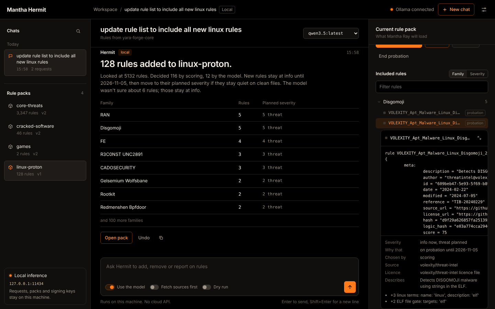
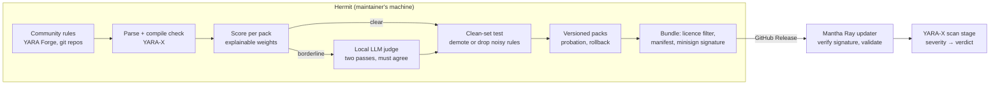

# Mantha Hermit

**Curates community YARA rules into signed rule packs for [Mantha Ray](#related-projects), a Linux malware-triage tool for PC game folders.**

Thousands of community YARA rules exist, but most aren't relevant to a given job. Some are noisy, some don't compile under YARA-X, and some have no licence. Hermit decides which rules belong in which pack, tests them against known-clean files, and ships the result as a signed bundle. Mantha Ray verifies the bundle before loading it.

```
hermit ask "update rule list to include all new rules related to video games"
hermit publish
```

Like its namesake crab, it lives in shells other creatures made: Mantha Ray's packs are built from rules other people wrote.



## The pipeline



## Try it (no model, no network, about 3 seconds)

```bash
python3 -m venv .venv && . .venv/bin/activate
pip install -e .
./scripts/demo.sh
```

The demo runs the whole chain on a handful of synthetic example rules:
1. Plain-English requests sort the rules into packs. A web-shell rule is left out as not applicable.
2. The clean-set test catches a rule that fires on a legitimate game's installer notes, and demotes it to `info`.
3. The packs are exported, signed and verified the way Mantha Ray will verify them.
4. A tampered bundle is rejected.

### Or the app

```bash
pip install -e '.[desktop]'  # once: its own window (pywebview + Qt), like Mantha Ray
./scripts/gui-demo.sh        # opens the app on the example rules
```

Type a request, and Hermit shows the pipeline step by step as it runs. Then it shows the result: rules by family, the clean-set result, and Apply and Undo buttons when a safety check needs your OK. The panel on the right is the live pack, with every rule's text, severity, source, licence and the reasons it was chosen. In your own setup, `hermit serve` opens the same app on your real packs, in its own window. Without the desktop extra, or with `--browser`, it opens in your browser instead. `hermit desktop-entry` adds it to your app menu.

## Design choices worth a look

- **The model only proposes; it never decides on its own.**
  - A local model (Ollama) is used for two narrow jobs: turning a request into a command, and judging borderline rules.
  - Its answers are validated against a fixed vocabulary. An invalid answer, such as `delete_everything`, is rejected and never run.
  - It never sets severity. When its two passes disagree, the rule is added at `info`, where it can't raise a verdict.
  - Rule text is treated as untrusted data in the prompt.
  - With no model at all, a rules-only parser still handles the common requests.
- **Safety before severity.**
  - New rules start on probation at `info`.
  - Rules that fire on known-clean files are demoted automatically.
  - Rules that YARA-X flags as slow are kept at `info`.
  - Big changes wait for approval, and every version can be rolled back.
- **Supply-chain hygiene for the bundle.**
  - minisign (Ed25519) signatures, with the trusted comment bound to the bundle version and hash.
  - Per-pack SHA-256 digests you can check with `sha256sum`.
  - Deterministic archives.
  - Extraction that refuses links and path escapes.
  - Mantha Ray compiles from rule text unless pre-compiled rules come from a verified bundle built with the same YARA-X version.
- **A strict, documented contract.** [docs/bundle-contract.md](docs/bundle-contract.md) is the boundary between Hermit and Mantha Ray, and [`hermit/contract.py`](hermit/contract.py) is its reference validator.
- **A local web app that treats rule data as hostile.**
  - It's served only on `127.0.0.1`, and checks the Host header to block DNS rebinding.
  - Every API call needs a token created when the server starts.
  - A strict Content-Security-Policy blocks inline scripts and anything loaded from elsewhere.
  - The page only ever inserts rule names and rule text as text, never as HTML.
  - It uses the standard library only, with no npm or build step.
- **Explainable sorting.** `hermit explain <rule>` shows every point a rule scored in every pack and why.
- **Licences tracked per rule.** Rules without a known licence stay out of published bundles.

## What it found on real rule sets

| | YARA Forge core (5,137 rules) | signature-base + ReversingLabs (7,145) |
|---|---|---|
| `core-threats` | 3,347 in, 383 borderline | 2,158 in, 415 borderline |
| `games` | 2 in, 6 borderline | 2 in |
| `cracked-software` | 46 in, 44 borderline | 12 in, 11 borderline |
| Not applicable to any pack | 285 | 916 (774 web shells) |
| Don't compile with YARA-X | 0 | 26 |

- **Public rule sets have almost no game-specific rules.** So `games` has to be largely hand-written, and public rules carry `core-threats`.
- **About 600 signature-base rules only compile once `filename`, `filepath` and `extension` are defined.** The contract therefore makes those externals explicit.
- **YARA Forge gives 91% of its rules the same score**, so name prefixes (`SUSP_`, `PUA_`, `Tool_`) are used to lower severity. Without this, `Cheat Engine` would have been rated a threat.
- **About 2,000 Forge rules carry no licence URL.** The licence filter keeps them out of published bundles.
- **On a home PC with `qwen2.5:7b-instruct`,** judging takes about 11 seconds per borderline rule (two passes). After the first fill, weekly runs only judge new rules.

## Using it for real

```bash
hermit fetch                                   # YARA Forge core by default (config/sources.toml)
hermit ask "add new video game rules" --dry-run
hermit ask "add new video game rules"
hermit ask "what changed in games this week?"
hermit keygen && hermit publish --no-push      # sign a bundle locally
hermit serve                                   # the same, in the app window
```

Local model (optional): install [Ollama](https://ollama.com) and run `ollama pull qwen2.5:7b-instruct`, or set `[ollama] model` in `config/hermit.toml`. Without it, borderline rules wait for a later run.

More: [how it works](docs/how-it-works.md) (commands, sorting, severity, scheduling, tuning) · [bundle contract v1](docs/bundle-contract.md).

## Project layout

```
hermit/
  cli.py        commands
  ask.py        plain-English requests → validated plan → pack update
  server.py     `hermit serve`: local web app and JSON API (standard library only)
  web/          the web app's HTML, CSS and JS (no build step)
  families.py   readable malware-family labels for grouping rules
  intent.py     rules-only request parser (no model)
  llm.py        Ollama client, request interpreter, borderline judge
  parse.py      YARA parsing (plyara), compile checks, licences
  features.py   file-type detection and rule features
  classify.py   explainable per-pack scoring and severity
  pipeline.py   load → score → judge
  livepacks.py  versioned live packs, probation, rollback
  cleantest.py  clean-set scanning
  contract.py   bundle contract v1: writer and strict validator
  bundle.py     export, deterministic archive, publish, verify, safe extract
  signing.py    minisign-compatible Ed25519 signing and verification
config/         packs (categories.toml), sources, settings
examples/       synthetic rules and a clean file for the demo
tests/          unit tests (python -m unittest)
```

## Status

Version 0.4.1, built for Mantha Ray's YARA-X stage:
- **Done:** the bundle contract, signed publishing and verification, and the local web app.
- **Next:** a user mode for local changes layered on top of the official packs, `local:` packs, and pack export, import and community sharing.

## Related projects

- **Mantha Ray:** offline malware triage for game folders on Linux (ClamAV, capa and FLOSS, with a YARA-X stage that loads Hermit's packs), run in a hardened, network-less scan container.
- **Mantha Reef:** a VS Code extension that scans workspaces for security issues and uses Mantha Ray to triage files.

## License

[MIT](LICENSE) © 2026 Shashank Mantha. The example rules in `examples/rules/` are CC0. Rules that Hermit packages from other sources keep their own upstream licences, which are recorded per rule in every bundle.
